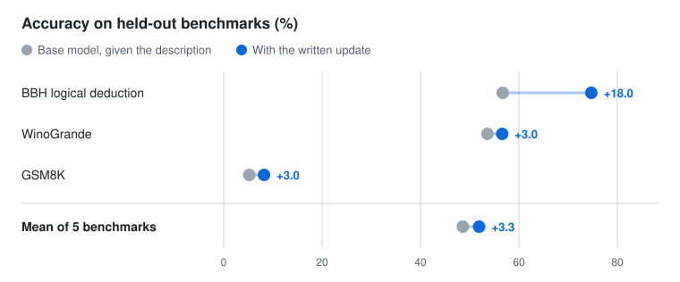

<h1 align="center">Text to Weights</h1>

<p align="center">
  <b>One sentence in. A task-specific LoRA out in under 2 seconds. No gradient steps.</b>
</p>

<p align="center">
  <a href="#results">Results</a> ·
  <a href="#method">Method</a> ·
  <a href="#quickstart">Quickstart</a> ·
  <a href="#citation">Citation</a> ·
  <a href="https://roicohen.org/blog/compress-backpropagation/">Original post</a>
</p>

<p align="center">
  <picture>
    <source media="(prefers-color-scheme: dark)" srcset="assets/results_dark.svg">
    
  </picture>
</p>

## Overview

Fine-tuning a model for a new task normally means collecting data and running gradient descent. This repository reproduces a different idea, introduced by Roi Cohen and Ben Shapira: train a **meta-model** that reads a plain-English task description and writes the weight update directly.

At inference time there is no training loop. A description goes in, and a standard LoRA adapter for Qwen3.5-2B comes out in 1.87 seconds, ready to load with `peft` or merge into the weights.

## Highlights

- **Latency.** 1.87 s from description to merged model.
- **Signal.** +5.3 points over a random update of the same size, reproduced on a second seed (+4.7).
- **Hold-out.** No training task shares a source dataset with any test benchmark.
- **Output.** A standard 16.9 MB PEFT LoRA (rank 8, 186 matrices). No custom inference code.

## Results

Accuracy (%) on five held-out benchmarks. The baseline is the same base model with the task description in its prompt, so the comparison isolates what the weight update adds.

| Benchmark | Base model, given the description | With the written update | Δ |
|---|:-:|:-:|:-:|
| BBH logical deduction (3 objects) | 56.7 | **74.7** | +18.0 |
| WinoGrande | 53.6 | **56.6** | +3.0 |
| GSM8K (final number) | 5.2 | **8.2** | +3.0 |
| **Mean of 5 benchmarks** | 48.6 | **51.9** | **+3.3** |

Meta-model trained on 282 tasks; scores from the second-seed model.

## Method

> **Task description** → frozen text encoder → **meta-model** → rank-8 LoRA → **Qwen3.5-2B, adapted**

1. **Teachers.** Train one rank-8 LoRA per task: 282 tasks from Super-NaturalInstructions, 500 examples each.
2. **Stage 1: imitation.** The meta-model learns to write each teacher's LoRA from that task's description.
3. **Stage 2: task loss.** The meta-model is trained end to end on the task loss, backpropagating through the frozen base model.
4. **Inference.** A new description produces an update for all 186 projection matrices in a single forward pass.

| Component | Choice |
|---|---|
| Base model | Qwen3.5-2B (frozen) |
| Description encoder | bge-large-en-v1.5 (frozen, 1024-d) |
| Meta-model | 125M-parameter MLP trunk with a head per projection type |
| Update | Rank 8 on all 12 projection types in all 24 layers |
| Hardware | One 24 GB GPU |

## Quickstart

Turn a description into a LoRA:

```bash
python scripts/export_peft.py --meta <meta-model checkpoint>.pt \
  --description "Decide which of two sentences goes against common sense." \
  --out adapter
```

Load it like any other adapter:

```python
from transformers import AutoModelForCausalLM
from peft import PeftModel

base = AutoModelForCausalLM.from_pretrained("Qwen/Qwen3.5-2B", dtype="bfloat16", device_map="cuda")
model = PeftModel.from_pretrained(base, "adapter").merge_and_unload()
```

See [USAGE.md](USAGE.md) for the timing breakdown.

## Reproducing

The scripts expect the repository at `/workspace/text-to-weights` and one 24 GB GPU.

```bash
pip install -r requirements.txt
bash scripts/setup_box.sh
bash scripts/download_models.sh            # Qwen3.5-2B, bge-large-en-v1.5, Text-to-LoRA task configs
python scripts/build_train_tasks.py        # training tasks
python scripts/build_heldout.py            # decontaminated held-out benchmarks
python scripts/train_teachers.py           # one LoRA per task
bash scripts/run_dose.sh 282 strict data/train_tasks.json   # stage 1, stage 2, evaluation
```

| File | Purpose |
|---|---|
| `scripts/meta_model.py` | Meta-model: encoder, trunk, per-projection heads |
| `scripts/train_meta.py` | Stage 1 and stage 2 training |
| `scripts/train_teachers.py` | Teacher LoRAs |
| `scripts/eval_arms.py` | Evaluation of the base model, written update and random update |
| `scripts/export_peft.py` | Description to PEFT adapter |
| `scripts/delta_hooks.py` | Applies a written update to the base model |

## Next steps

Scaling the number of training tasks and widening the benchmark set.

## Citation

```bibtex
@misc{text-to-weights-proof-of-concept,
  title  = {Text to Weights: a reproduction of description-conditioned weight generation},
  author = {Ganto12},
  year   = {2026},
  url    = {https://github.com/Ganto12/text-to-weights-proof-of-concept}
}
```

## Acknowledgements

The method and original results are from Roi Cohen and Ben Shapira, [Can we compress backpropagation into a model?](https://roicohen.org/blog/compress-backpropagation/). Task configurations come from [Text-to-LoRA](https://github.com/SakanaAI/text-to-lora) (Sakana AI).

## License

[MIT](LICENSE)
